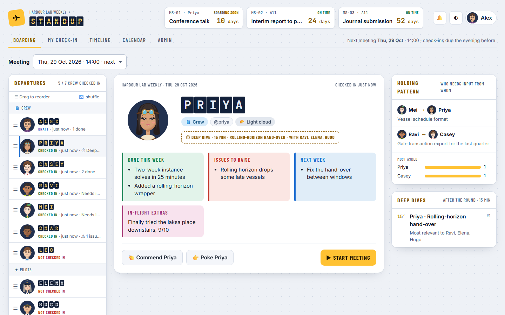

# Team Standup

### ▶ [Try the live demo](https://team-standup-demo.sutdpm.workers.dev)

[](https://team-standup-demo.sutdpm.workers.dev)

The demo runs entirely in your browser, so nothing you type leaves your tab. The bar at the bottom of the page lets you view the app as any teammate, including the professors, and **Reset demo** starts again from the sample data.

A weekly check-in and meeting board for research teams. Everyone checks in before the meeting with what they finished, what they need raised, who they are waiting on and what comes next. Meeting mode then puts every avatar on screen and runs a soft 5 + 5 minute slot per person, with deep dives after the round. Long-range deadlines sit in the header as countdowns. One deployment hosts any number of projects, each with its own people, admins, calendar and colour theme.

I built it for my own research team at the Singapore University of Technology and Design, where it replaced weekly one-slide PowerPoint updates. This public copy uses a fictional team and fictional data.

## How it is built

| Part | What it uses |
|---|---|
| API | A Cloudflare Worker written with [Hono](https://hono.dev), one file per route group under `src/worker/routes` |
| Database | Cloudflare D1 (SQLite), with numbered migrations in `migrations/` that are never edited once committed |
| Sign-in | Cloudflare Access; the Worker verifies the Access JWT on every request (`src/worker/auth.ts`) |
| Client | React and Vite in `src/client`; colours come only from design tokens in `src/client/styles/tokens.css`, with light and dark values |
| Shared logic | Pure functions and types in `src/shared`, used by both sides and covered by unit tests |
| Tests | Vitest unit tests, Worker integration tests in the Workers runtime, and Playwright walkthroughs at desktop and phone sizes |
| CI | GitHub Actions runs the typecheck and tests on every push |

The demo reuses the production code unchanged. `src/demo/boot.ts` loads [sql.js](https://sql.js.org) (SQLite compiled to WebAssembly), applies the same migrations and seed data, wraps it in a small D1 stand-in (`src/demo/d1.ts`), and routes the page's `/api` requests to the Worker's own `fetch` handler inside the tab. The demo is therefore a set of static files, with no server to scale and nothing shared between visitors.

The project was written with Claude Code. `CLAUDE.md` holds the working rules, and `.claude/hooks/guard.mjs` enforces the mechanical ones, such as immutable migrations and colours only from tokens.

## Run it locally

```bash
npm install
npm run db:reset:local
npm run dev
```

Create `.dev.vars` first with `DEV_USER=alex.tan@example.edu` and the lines `ACCESS_TEAM_DOMAIN=` and `ACCESS_AUD=` left blank, then open http://localhost:5173. Localhost skips Cloudflare Access and signs you in as `DEV_USER`; the bar at the bottom of the page switches teammates.

| Command | What it does |
|---|---|
| `npm test` | Unit and Worker integration tests |
| `npm run e2e` | Playwright walkthroughs at desktop and phone sizes |
| `npm run check` | Typecheck and tests together, as CI runs them |
| `npm run demo` | The in-browser demo with hot reload |
| `npm run demo:build` | The static demo in `dist-demo/` |
| `npm run demo:deploy` | Builds the demo and uploads it as static files (`wrangler.demo.jsonc`) |

## Deploy your own

`docs/MAINTAINING.md` walks through creating the D1 database and the Access application, releases, migrations, rollback and backups. Put your database id in `wrangler.jsonc`, then run `npm run deploy`. The free plans of Workers, D1 and Zero Trust cover a team of up to 50 people.

## Documents

| Document | Covers |
|---|---|
| [docs/SPEC.md](docs/SPEC.md) | Problem, audience, decisions, data model and backlog |
| [docs/MAINTAINING.md](docs/MAINTAINING.md) | Cloudflare setup, releases, migrations, rollback, backups and launch day |
| [CHANGELOG.md](CHANGELOG.md) | Patch notes, which the app also shows as "What's new" |
| [CLAUDE.md](CLAUDE.md) | Working rules for Claude Code |

## Licence

MIT. See `LICENSE`.
